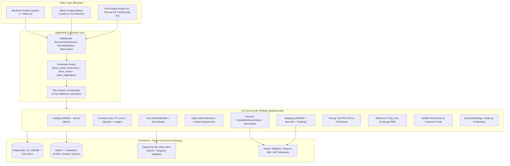
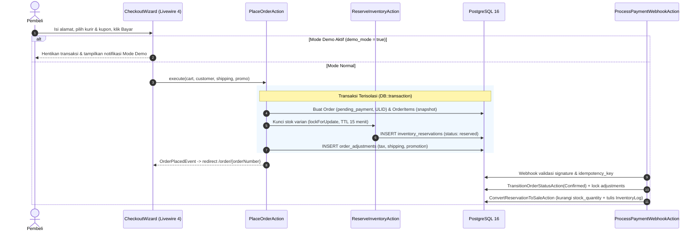

# 00. System Architecture Overview & Global Design

## 1. Ikhtisar Arsitektur Sistem

**NusoraCommerce** dibangun menggunakan arsitektur **Single-Instance Universal Modular Monolith** di atas **Laravel 12** (PHP 8.2/8.3+), **Livewire 4**, **Tailwind CSS v4**, dan **PostgreSQL 16+**. Seluruh domain bisnis dipisahkan secara eksplisit di bawah `app/Domain/` dengan komunikasi melalui Domain Actions, Value Objects, dan Domain Events.

---

## 2. Alur Transaksi & Invarian Inti

