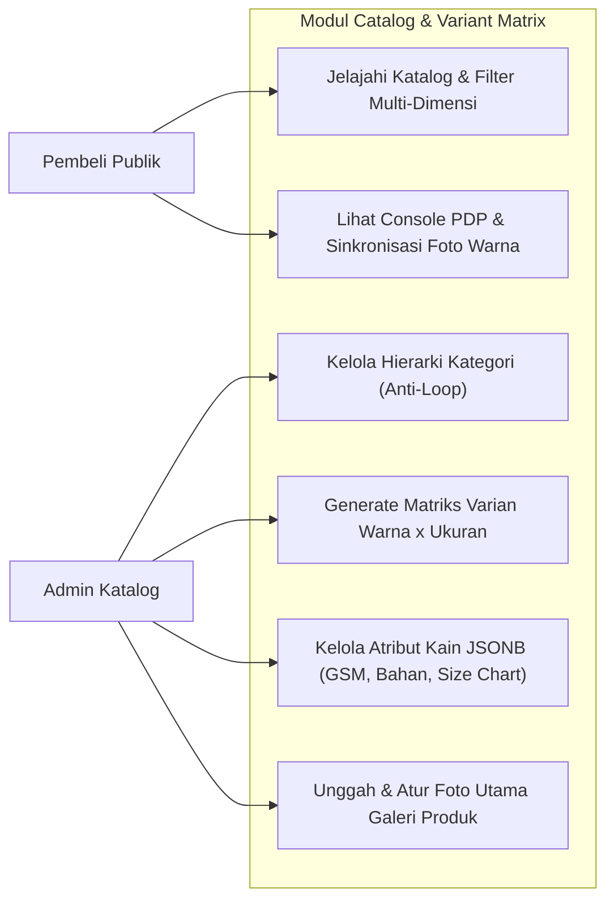
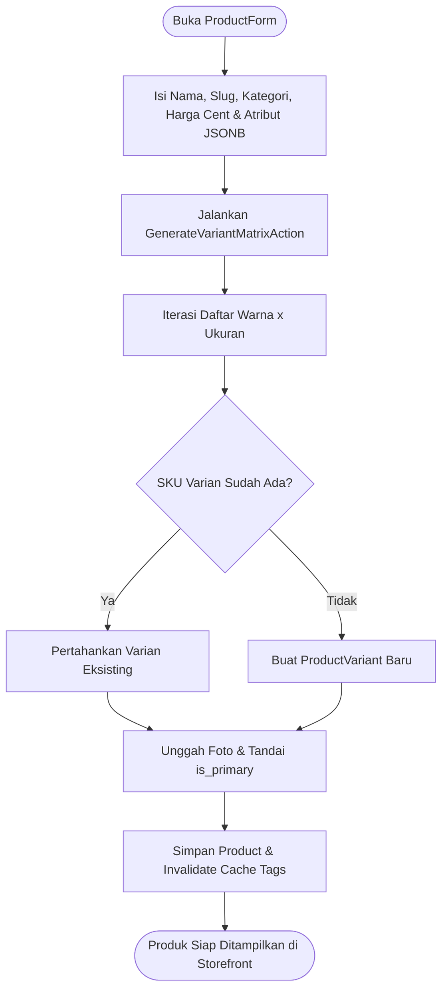
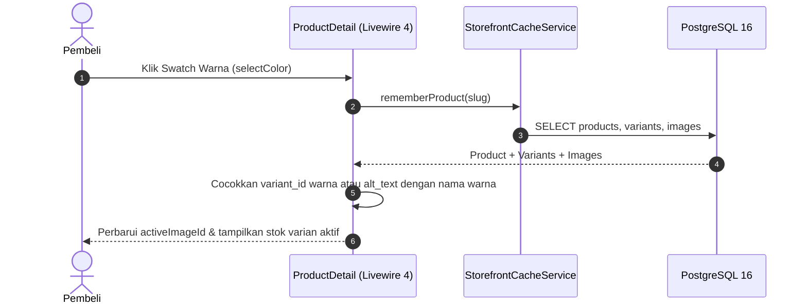
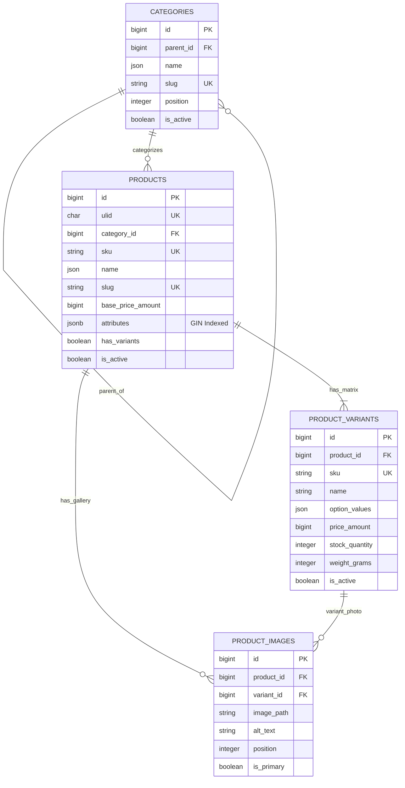

# 01. Catalog, Dynamic JSONB Attributes & Variant Matrix

## 1. Ruang Lingkup & Komponen Aktual
- **Models**: `App\Domain\Catalog\Models\{Product, ProductVariant, ProductImage, Category}`
- **Actions**: `App\Domain\Catalog\Actions\GenerateVariantMatrixAction`
- **Livewire UI**: `Storefront\{Home, ProductCatalog, ProductDetail}`, `Admin\Products\{ProductList, ProductForm}`, `Admin\Categories\CategoryManager`

## 2. Use Case Diagram

## 3. Activity Diagram

## 4. Sequence Diagram (PDP Color-Image Sync)

## 5. Entity Relationship Diagram

