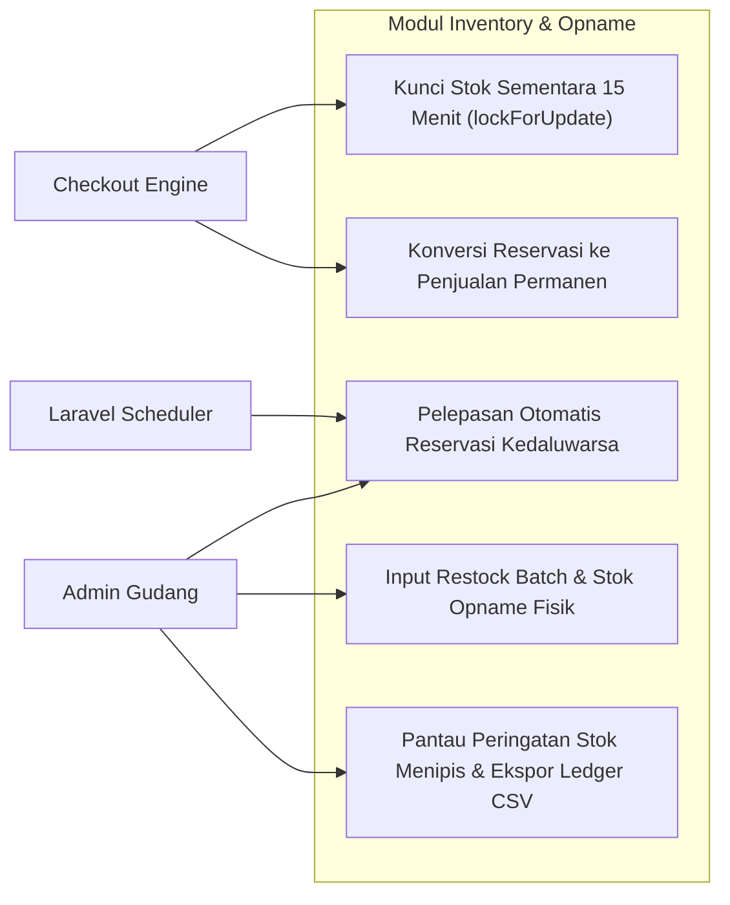
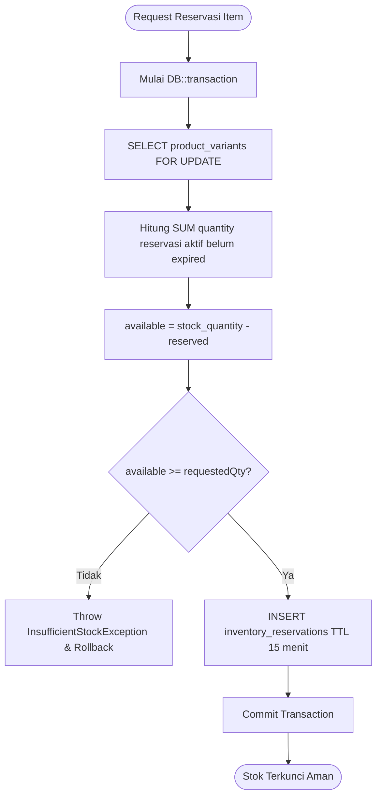
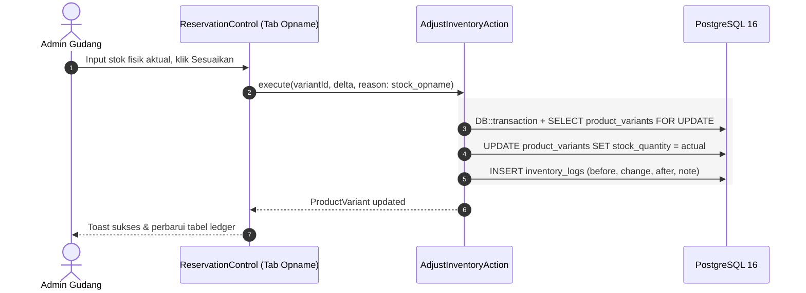
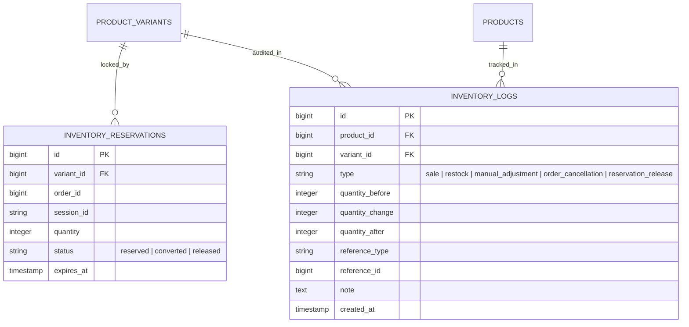

# 02. Inventory Concurrency, TTL Reservations & Stock Opname

## 1. Ruang Lingkup & Komponen Aktual
- **Models**: `App\Domain\Inventory\Models\{InventoryReservation, InventoryLog}`
- **Actions**: `ReserveInventoryAction`, `ConvertReservationToSaleAction`, `ReleaseExpiredReservationsAction`, `AdjustInventoryAction`
- **Scheduler**: `inventory:cleanup-expired-reservations` (tiap menit), `inventory:check-low-stock` (tiap jam)
- **Livewire UI**: `Admin\Inventory\ReservationControl` (3 Tab: Reservasi Aktif, Stok Menipis & Opname, Riwayat Mutasi)

## 2. Use Case Diagram

## 3. Activity Diagram (Pessimistic Reservation)

## 4. Sequence Diagram (Stock Opname & Audit Ledger)

## 5. Entity Relationship Diagram

