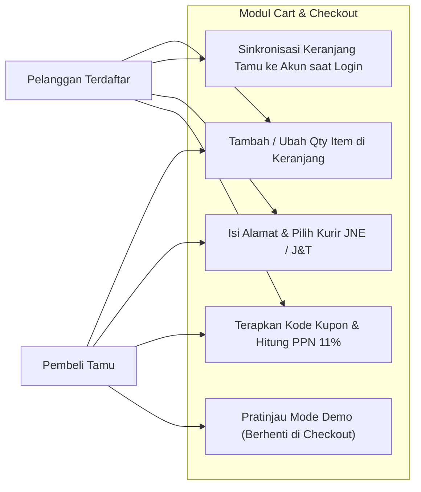
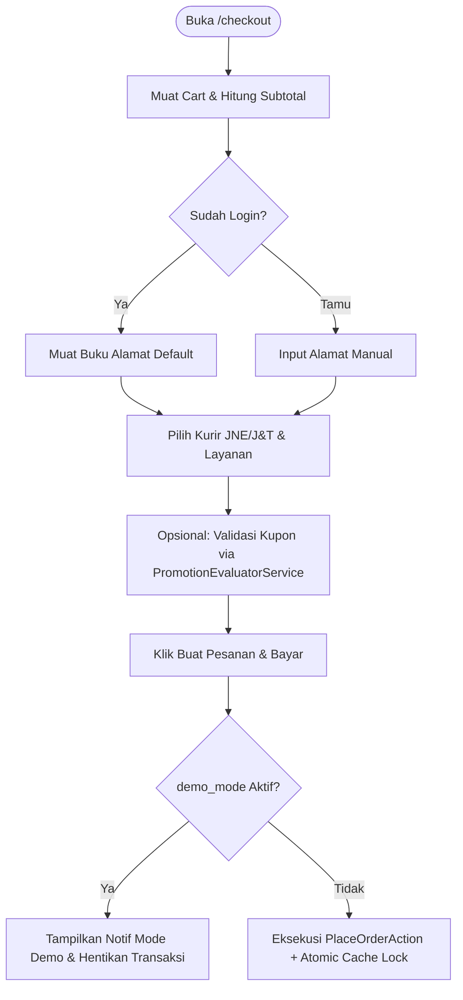
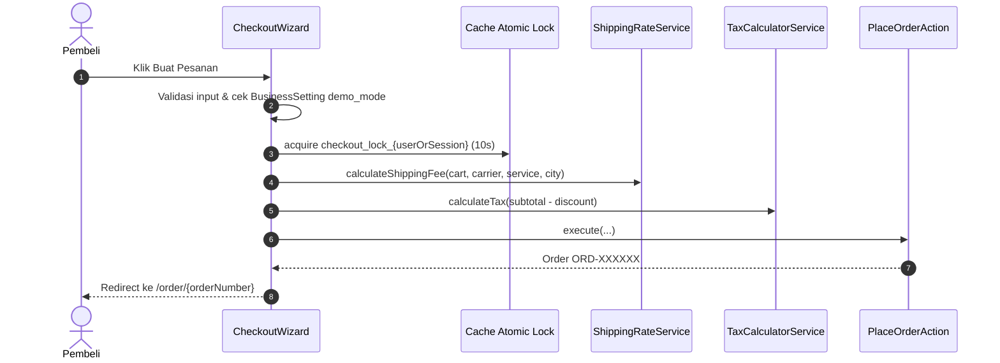
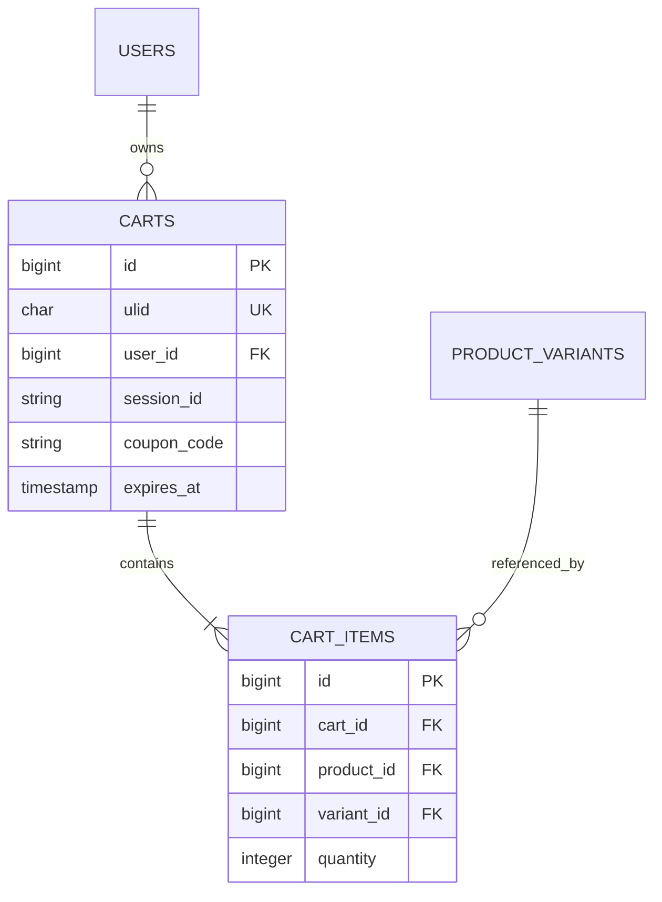

# 03. Persistent Cart & 3-Column Checkout Wizard

## 1. Ruang Lingkup & Komponen Aktual
- **Models & Services**: `App\Domain\Cart\Models\{Cart, CartItem}`, `App\Domain\Cart\Services\CartManager`
- **Livewire UI**: `Storefront\{CartDrawer, CartTrigger, CheckoutWizard}`

## 2. Use Case Diagram

## 3. Activity Diagram

## 4. Sequence Diagram

## 5. Entity Relationship Diagram

