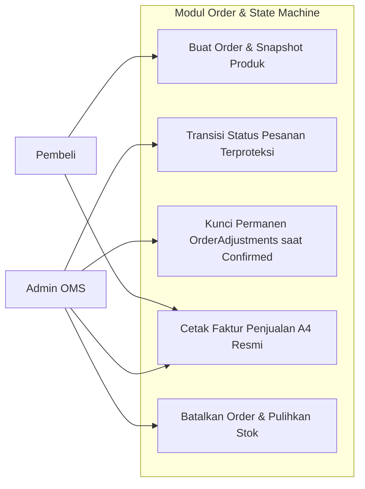
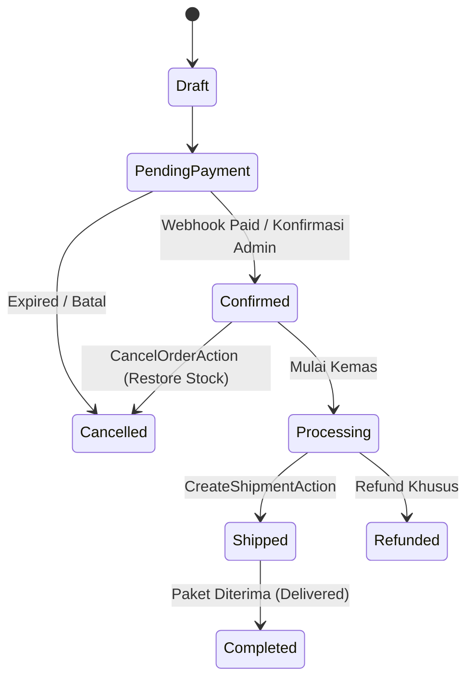
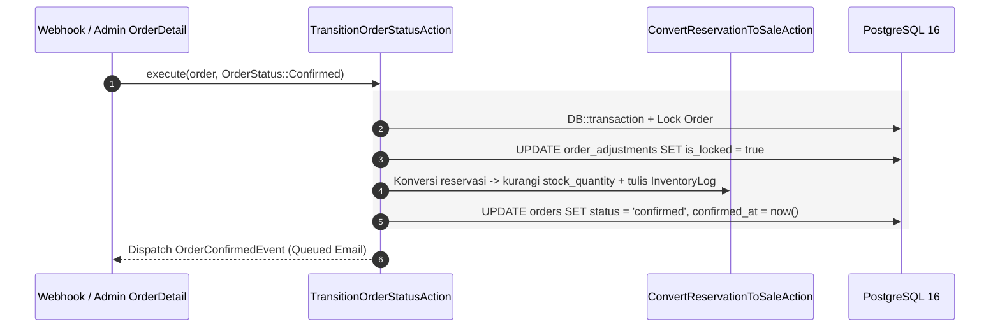
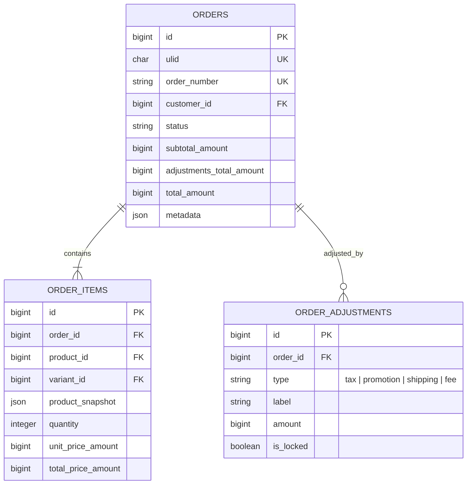

# 04. Orders, State Machine & Immutable Adjustments

## 1. Ruang Lingkup & Komponen Aktual
- **Models & Enums**: `Order`, `OrderItem`, `OrderAdjustment`, `OrderStatus`
- **Actions**: `PlaceOrderAction`, `TransitionOrderStatusAction`, `CancelOrderAction`
- **Invoice**: `OrderInvoiceController` + `resources/views/storefront/invoice.blade.php` (A4 Printable)

## 2. Use Case Diagram

## 3. Activity Diagram (Order State Machine)

## 4. Sequence Diagram

## 5. Entity Relationship Diagram

