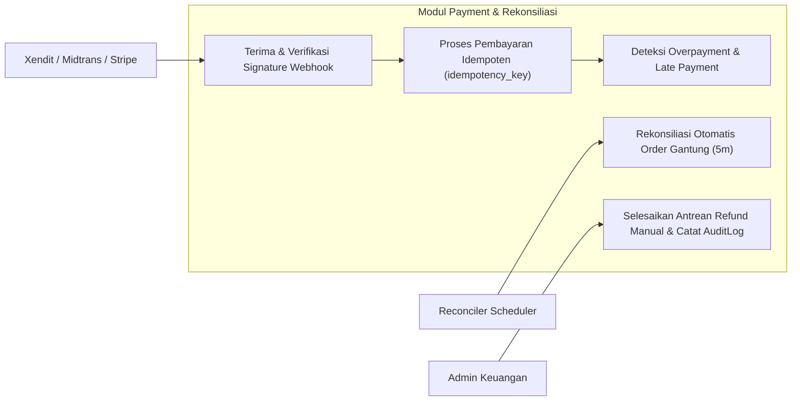
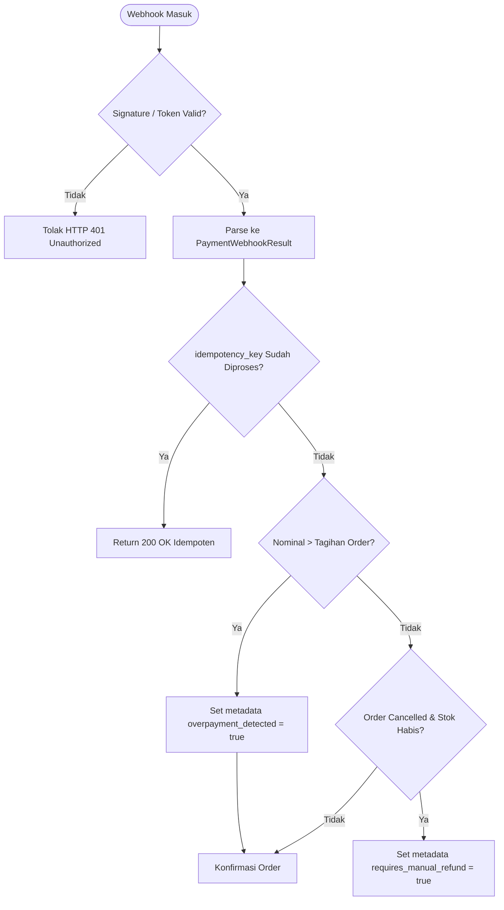
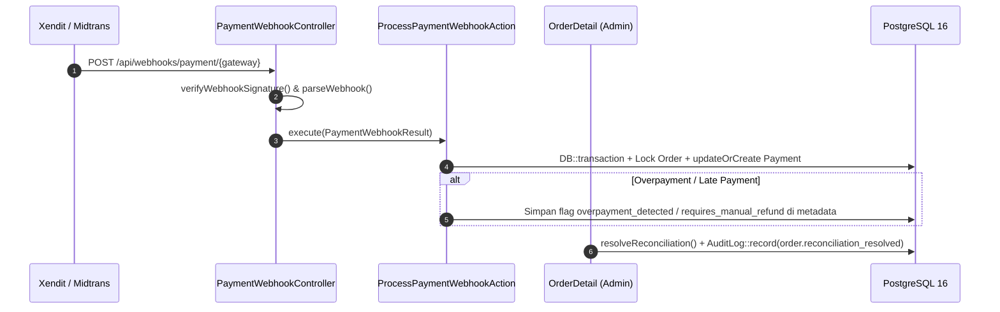
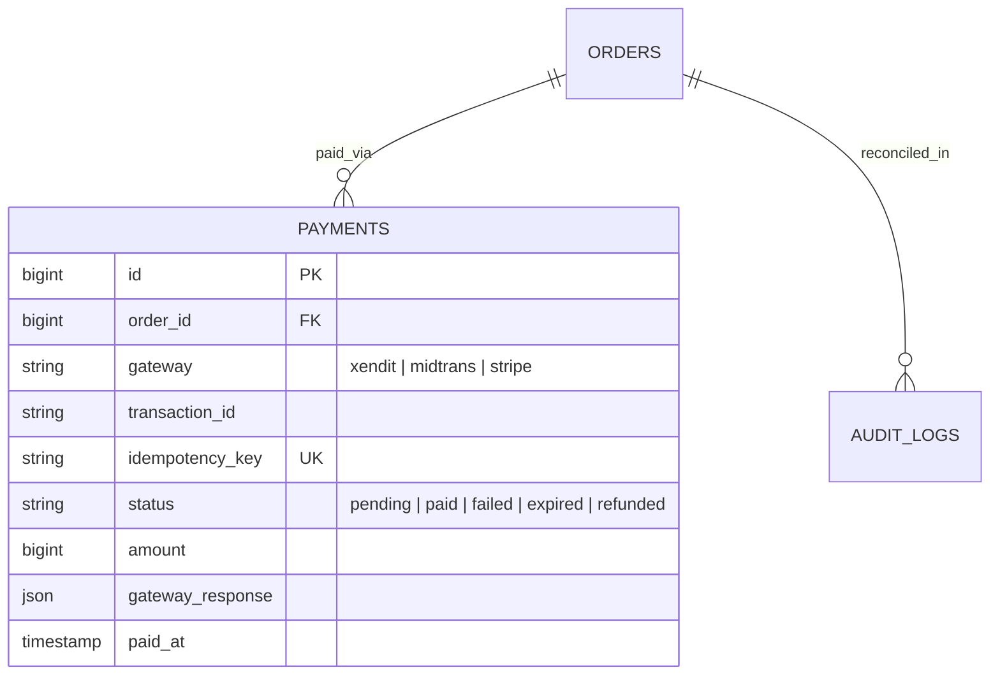

# 05. Multi-Gateway Payments, Webhooks & Reconciliation

## 1. Ruang Lingkup & Komponen Aktual
- **Gateways**: `XenditPaymentGateway`, `MidtransPaymentGateway`, `StripePaymentGateway`
- **Controllers & Actions**: `PaymentWebhookController`, `ProcessPaymentWebhookAction`, `PaymentReconcilerService`, `CircuitBreaker`
- **Admin UI**: `OrderList` (Tab `Perlu Rekonsiliasi`), `OrderDetail` (Panel Rekonsiliasi Pembayaran + `AuditLog`)

## 2. Use Case Diagram

## 3. Activity Diagram

## 4. Sequence Diagram

## 5. Entity Relationship Diagram

