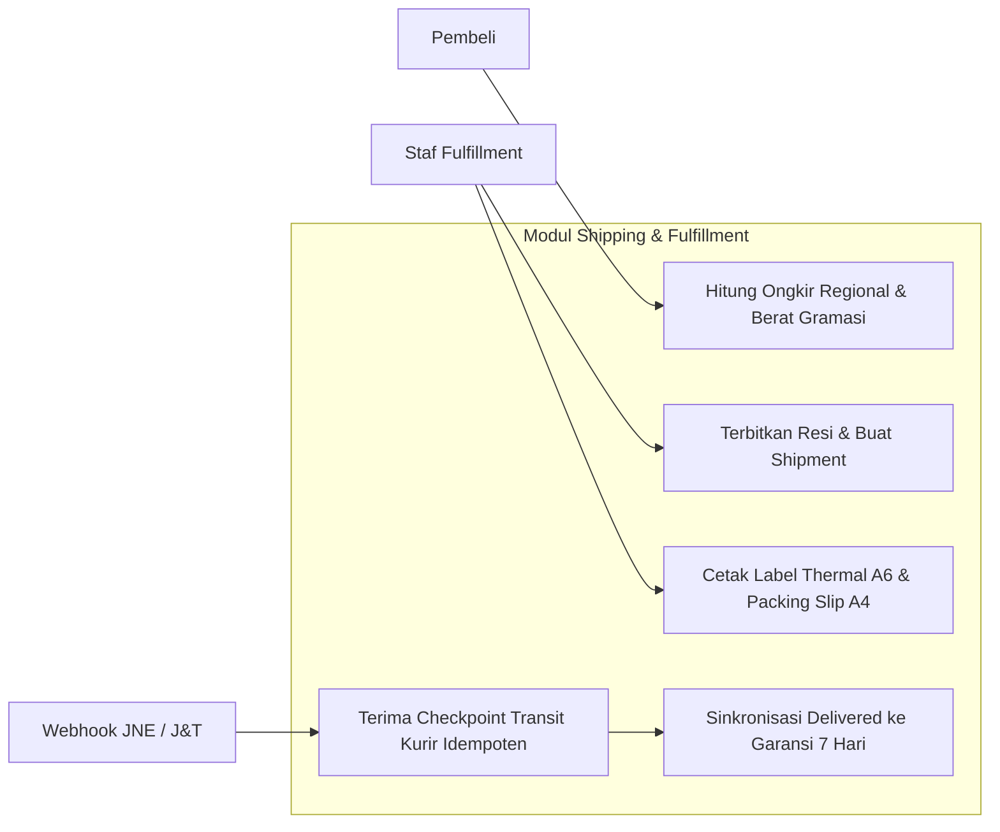
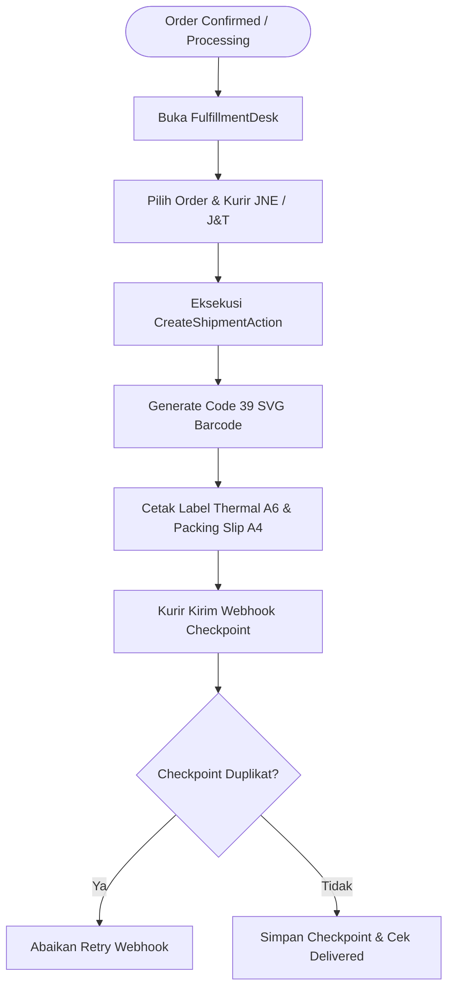
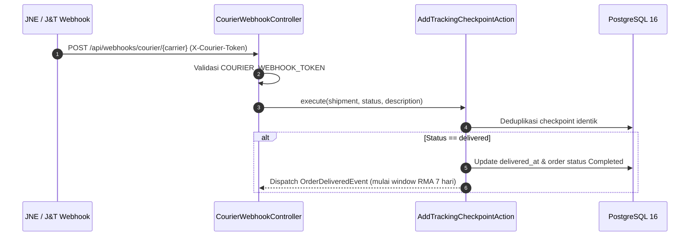
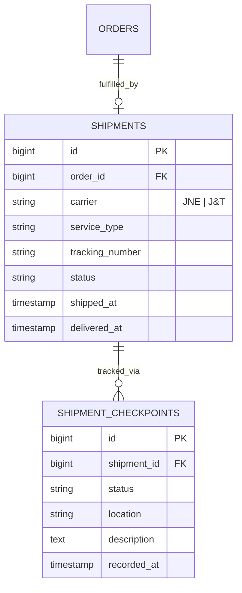

# 06. Shipping, Fulfillment Desk & Print Engine

## 1. Ruang Lingkup & Komponen Aktual
- **Models & Services**: `Shipment`, `ShippingRateService`, `JneCourierDriver`, `JtExpressCourierDriver`, `BarcodeGeneratorService`, `IndonesiaCity`
- **Actions & Controllers**: `CreateShipmentAction`, `AddTrackingCheckpointAction`, `CourierWebhookController`, `ShippingPrintController`
- **UI**: `Admin\Shipping\FulfillmentDesk`, `print-label.blade.php` (Thermal A6), `print-packing-slip.blade.php` (A4)

## 2. Use Case Diagram

## 3. Activity Diagram

## 4. Sequence Diagram

## 5. Entity Relationship Diagram

