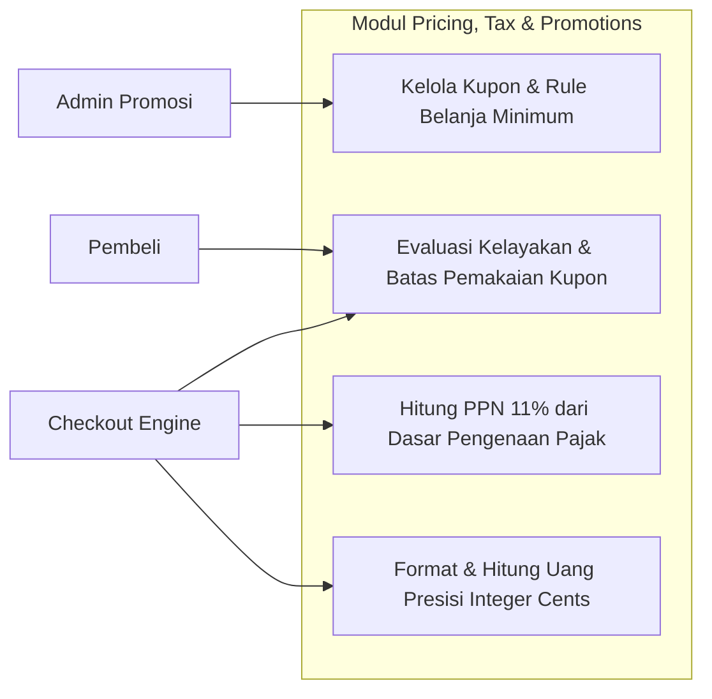
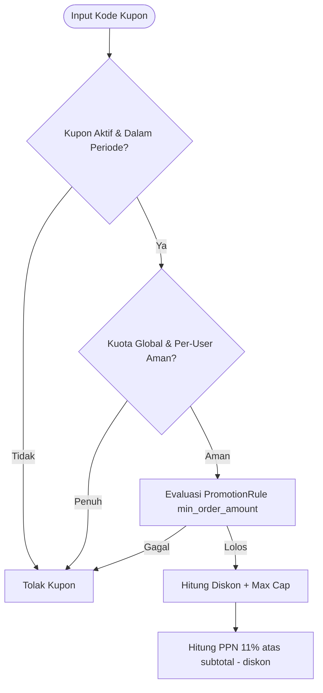
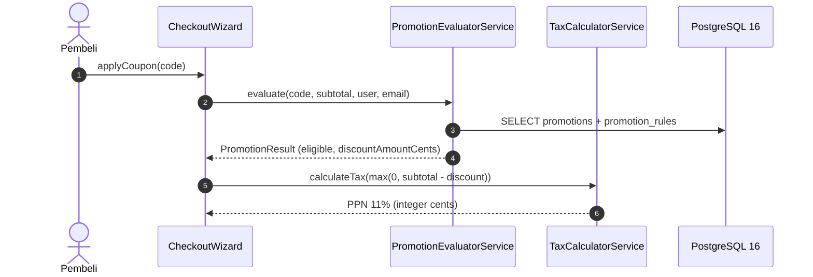
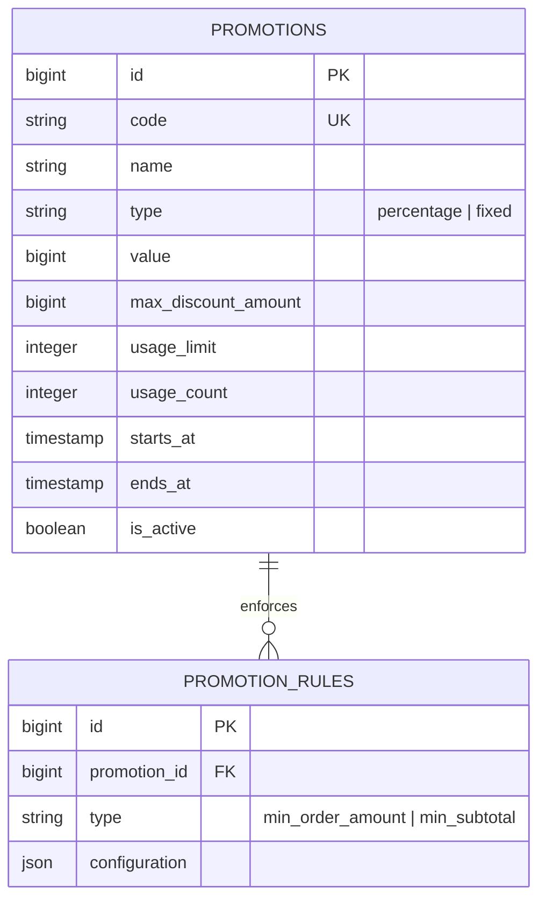

# 07. Pricing Value Object, PPN 11% & Rule-Driven Promotions

## 1. Ruang Lingkup & Komponen Aktual
- **Value Object**: `App\Domain\Pricing\ValueObjects\Money` (integer cents, zero floating-point)
- **Services & Models**: `TaxCalculatorService`, `PromotionEvaluatorService`, `Promotion`, `PromotionRule`
- **Admin UI**: `Admin\Promotions\PromotionManager`, `Admin\Analytics\FinancialReports`

## 2. Use Case Diagram

## 3. Activity Diagram

## 4. Sequence Diagram

## 5. Entity Relationship Diagram

