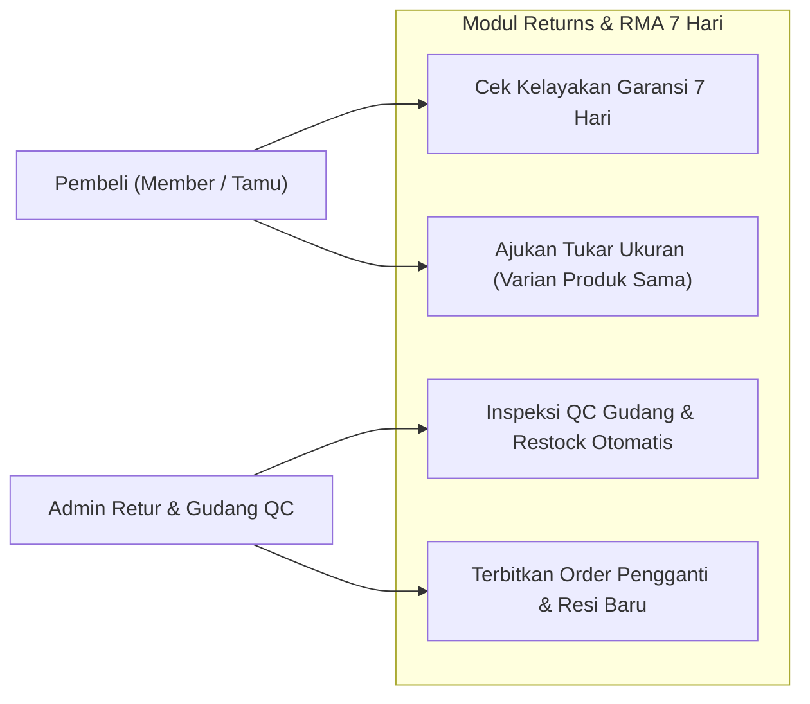
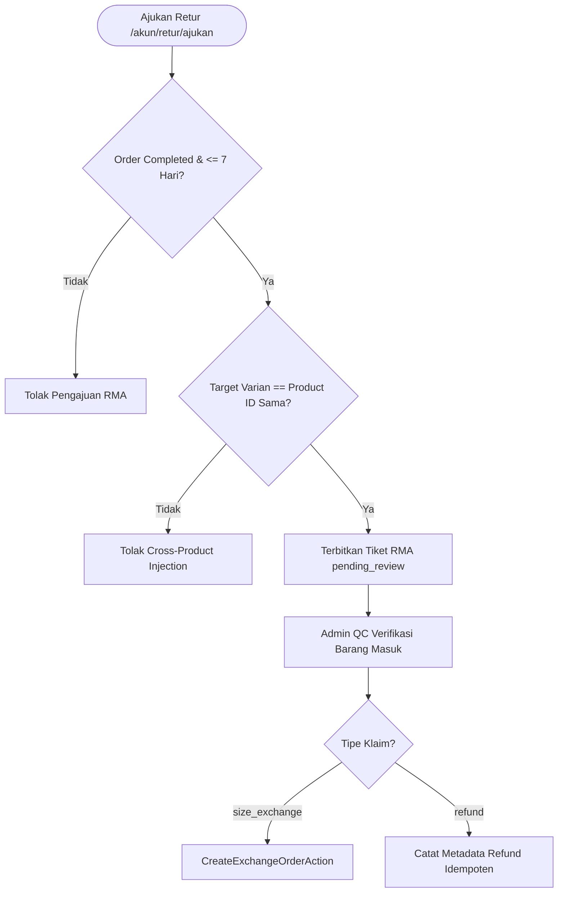
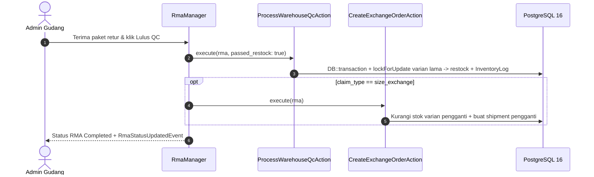
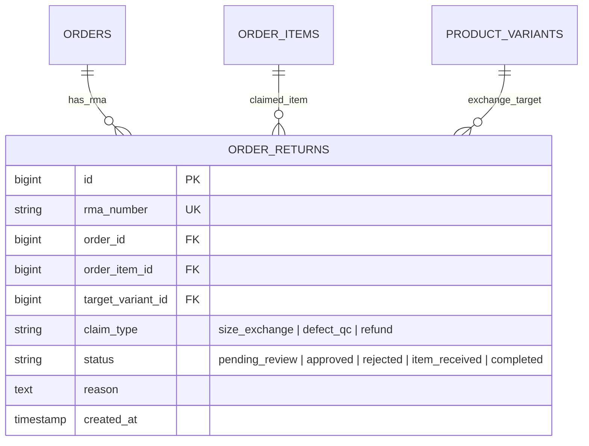

# 08. After-Sales Returns, 7-Day Size Exchange & RMA

## 1. Ruang Lingkup & Komponen Aktual
- **Models & Enums**: `OrderReturn`, `ReturnClaimType` (`size_exchange`, `defect_qc`, `refund`), `ReturnStatus`
- **Actions**: `ProcessWarehouseQcAction`, `CreateExchangeOrderAction`
- **UI**: `Storefront\{RmaRequestForm, SizeGuideModal}`, `Admin\Returns\RmaManager`

## 2. Use Case Diagram

## 3. Activity Diagram

## 4. Sequence Diagram

## 5. Entity Relationship Diagram

