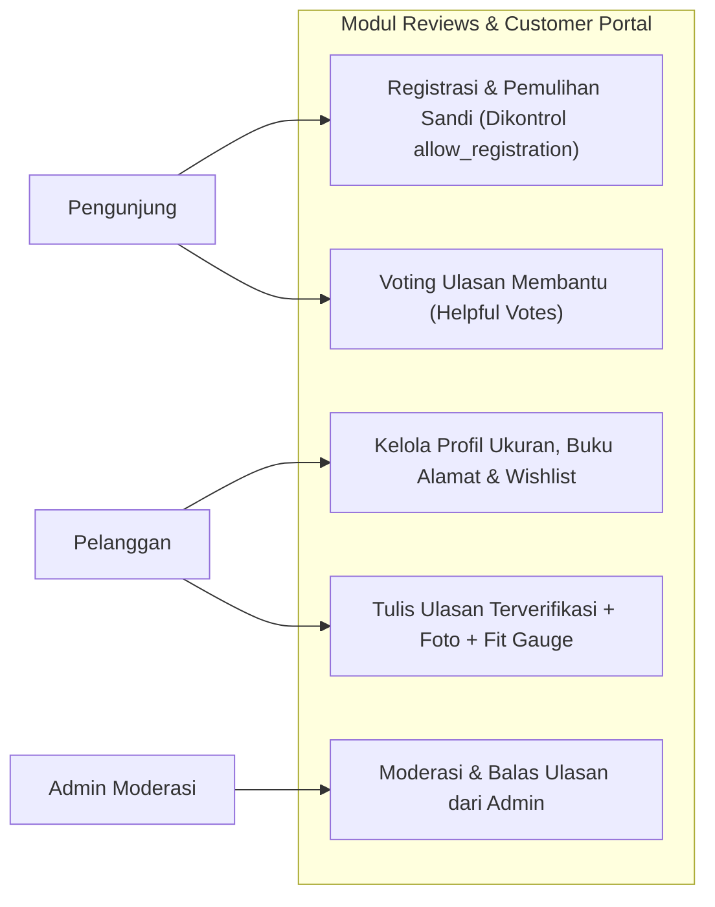
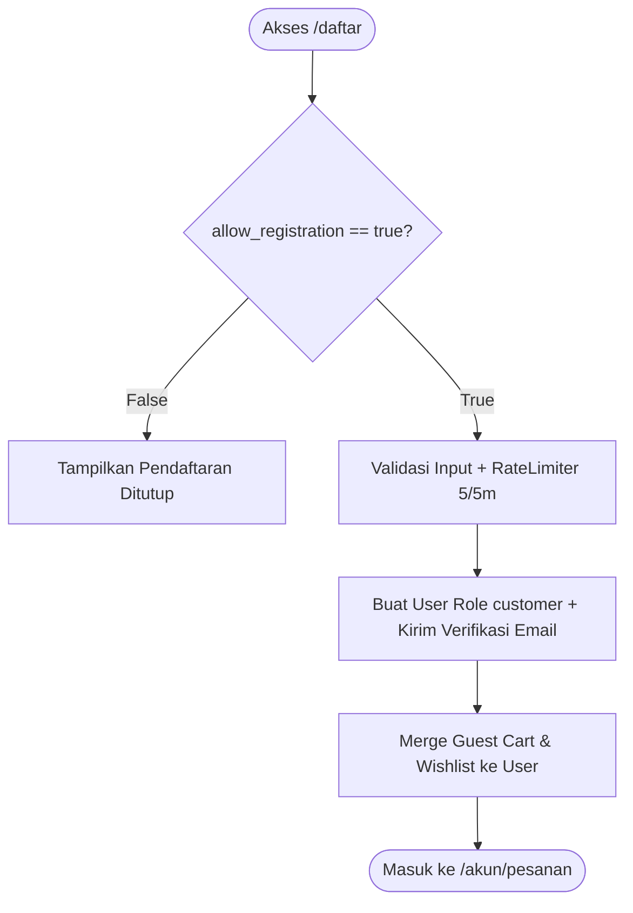
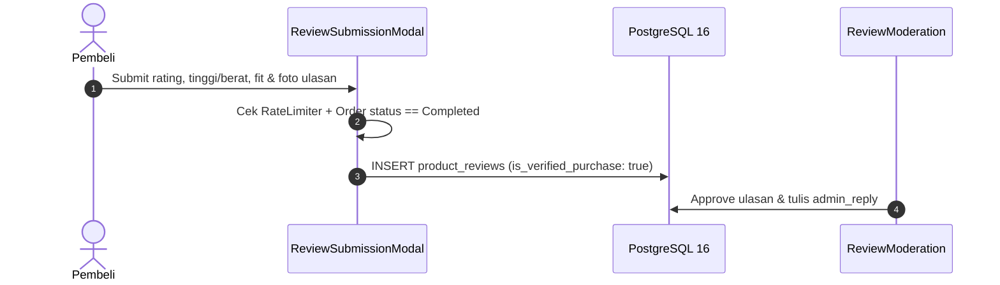
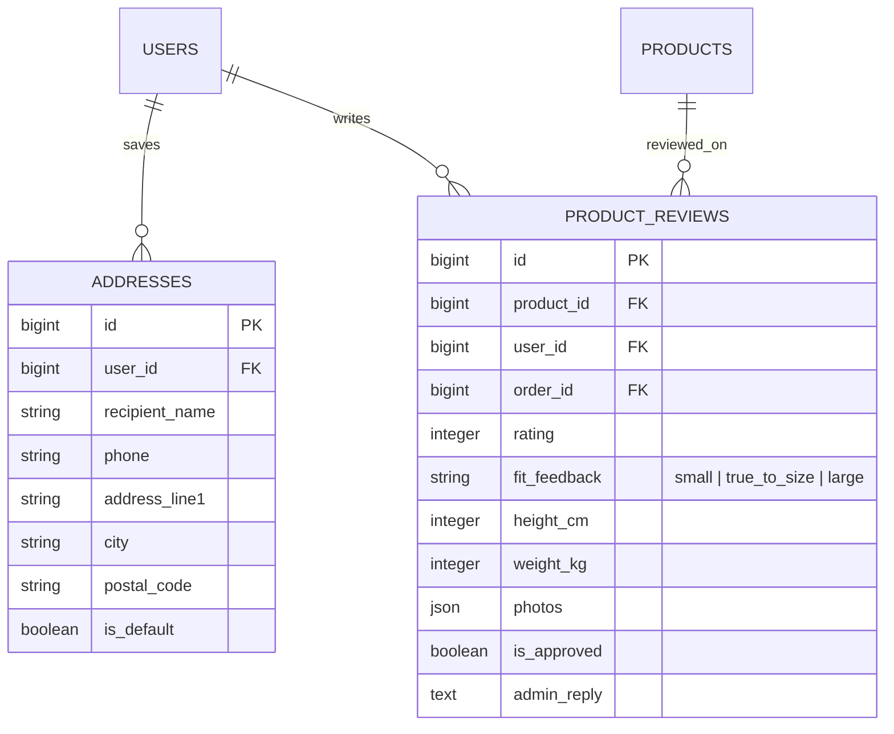

# 09. Verified Fit Reviews & Customer Portal

## 1. Ruang Lingkup & Komponen Aktual
- **Models**: `ProductReview`, `Address`, `User`
- **Storefront UI**: `CustomerLogin`, `CustomerRegister`, `CustomerForgotPassword`, `CustomerResetPassword`, `CustomerVerifyEmail`, `CustomerProfile`, `CustomerAddresses`, `CustomerOrders`, `CustomerWishlist`, `ReviewSubmissionModal`
- **Admin UI**: `Admin\Reviews\ReviewModeration`

## 2. Use Case Diagram

## 3. Activity Diagram

## 4. Sequence Diagram

## 5. Entity Relationship Diagram

