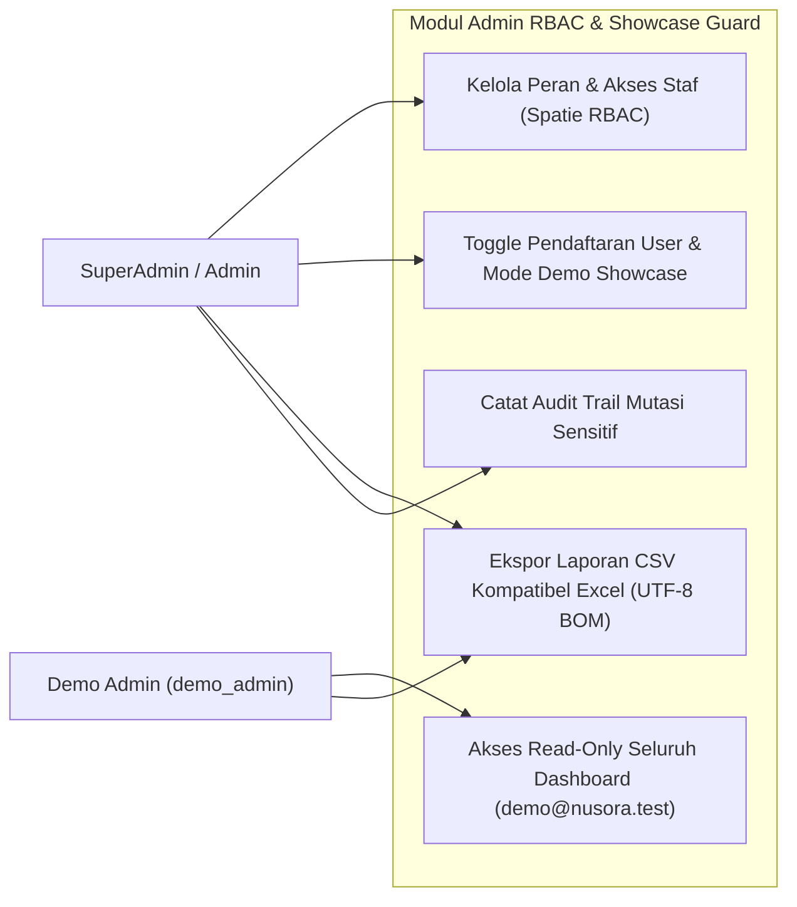
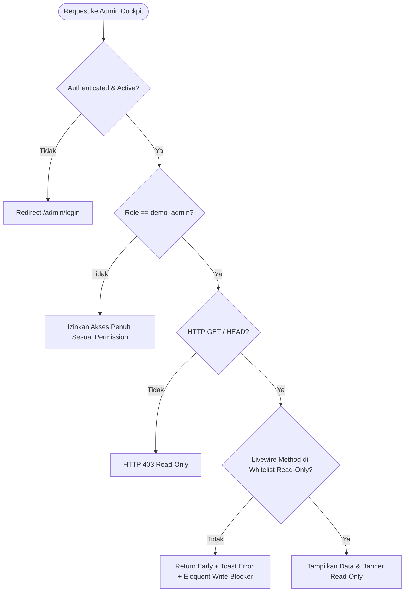
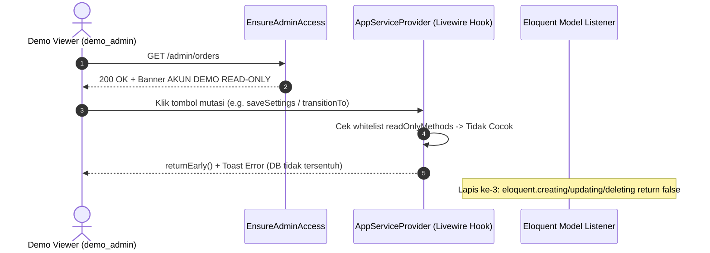
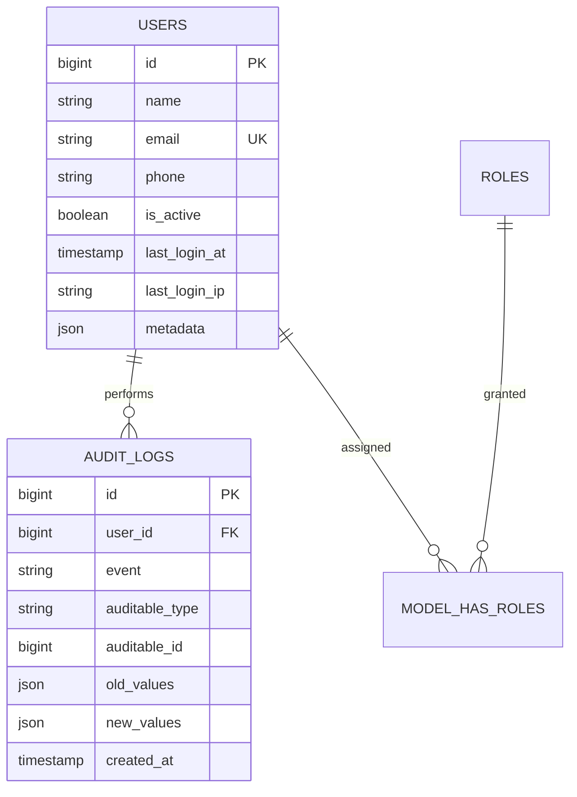

# 10. Admin Cockpit, RBAC, Demo Read-Only Guard & Audit Trail

## 1. Ruang Lingkup & Komponen Aktual
- **Auth & Middleware**: `EnsureAdminAccess`, `AdminLogin`, `SecurityHeadersMiddleware`, `AppServiceProvider` (`Gate::before`, `Livewire::listen('call')`, Eloquent write-blocker)
- **Models & Support**: `User`, `AuditLog`, `BusinessSetting`, `CsvExport` (UTF-8 BOM + CWE-1236)
- **Admin UI**: 17 Native Livewire 4 Components (tanpa Filament)

## 2. Use Case Diagram

## 3. Activity Diagram (3-Layer Demo Read-Only Guard)

## 4. Sequence Diagram

## 5. Entity Relationship Diagram

