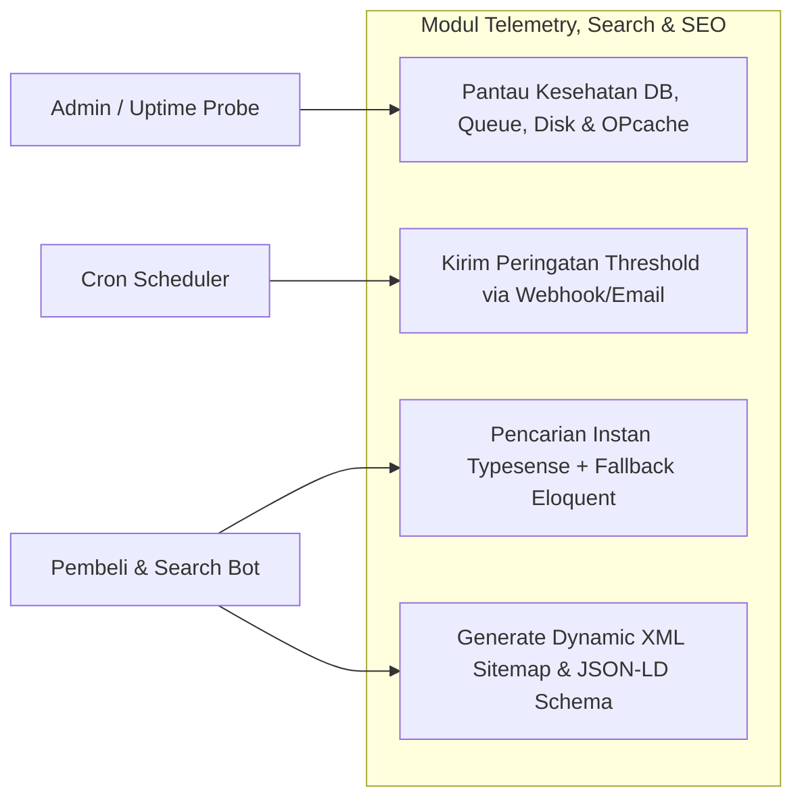
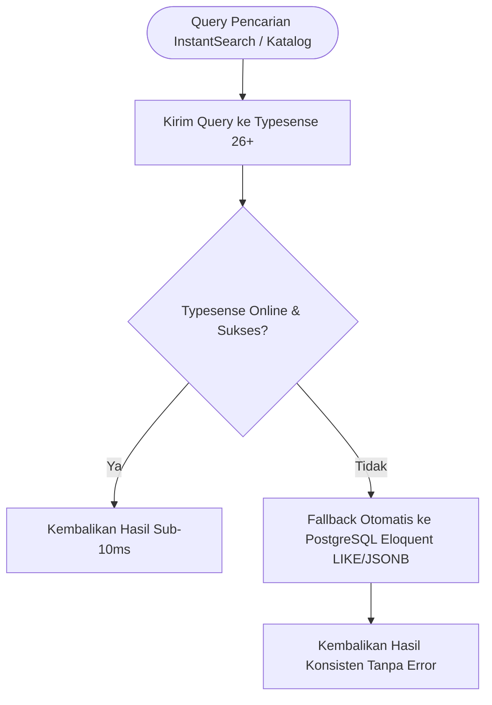
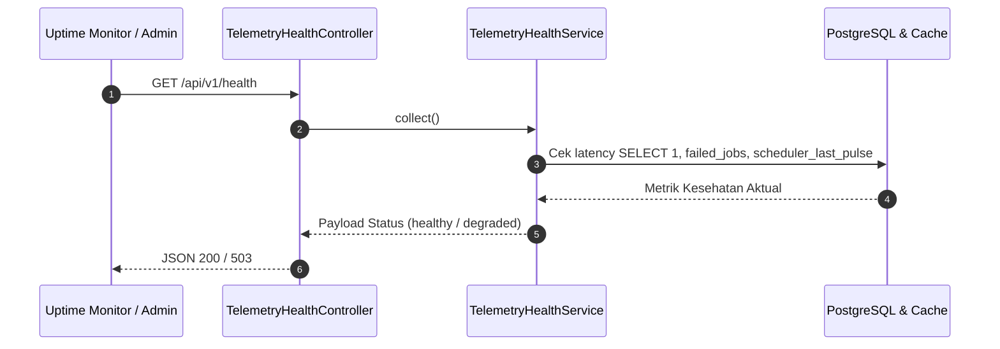
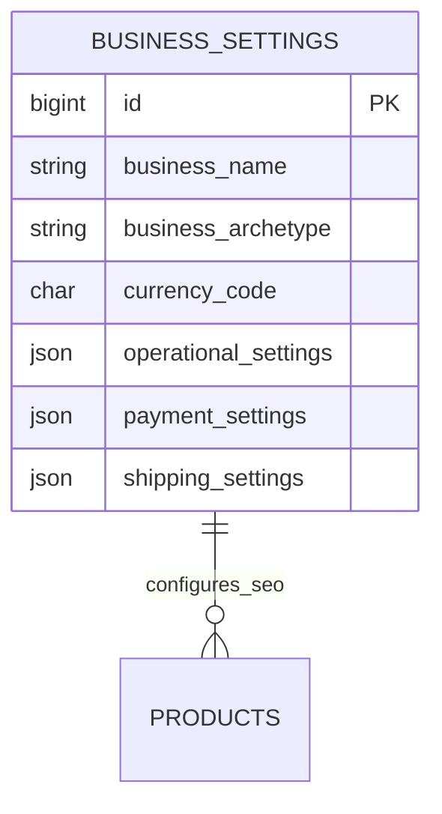

# 11. VPS Telemetry, Search Fallback & Dynamic SEO

## 1. Ruang Lingkup & Komponen Aktual
- **Services**: `TelemetryHealthService`, `TelemetryAlertService`, `TypesenseSearchService`, `SeoMetaService`, `StorefrontCacheService`, `WebPMediaOptimizer`
- **Controllers & CLI**: `TelemetryHealthController` (`/api/v1/health`, `/api/v1/health/ping`), `SeoController` (`/robots.txt`, `/sitemap.xml`), `nusora:telemetry`, `typesense:index`
- **UI**: `Admin\Monitoring\SystemMonitoring`, `Storefront\InstantSearch` (`Ctrl+K`)

## 2. Use Case Diagram

## 3. Activity Diagram (Resilient Search Fallback)

## 4. Sequence Diagram

## 5. Entity Relationship Diagram

